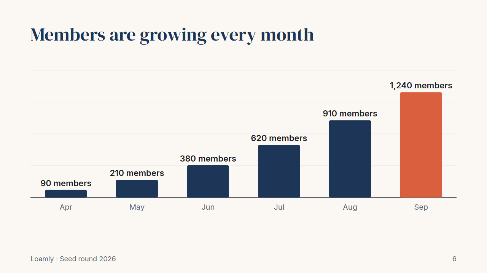
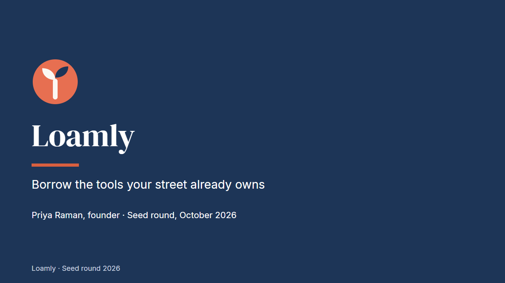
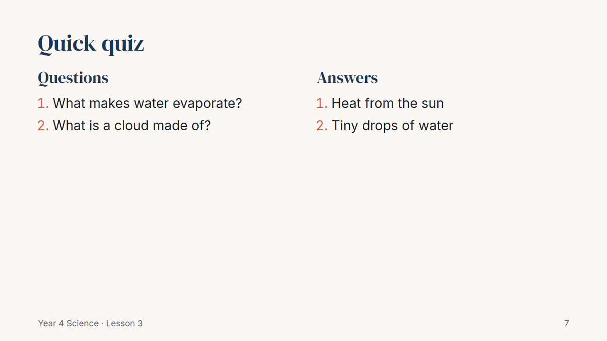

# Slide Deck Kit

> **Free CodePlate template, v1.1.4.** This repository mirrors the zip on [codeplate.io](https://codeplate.io/t/slide-deck-kit/).
> Press **Use this template** to start your own repository from it, or [download the zip](https://codeplate.io/t/slide-deck-kit/).
> [All templates](https://codeplate.io/) · [Free License](https://codeplate.io/license/free/) · subscribers get it under the [Pro License](https://codeplate.io/license/pro/) with no credit.



Branded slide decks written in plain Markdown, built so your AI agent can make *your* talks: pitches, lessons, conference talks, sales decks, reports.

## What's inside

- **Two finished sample decks** sharing one theme: a 10-slide startup pitch and an 8-slide lesson, with title, section, big-number, quote, two-column, picture and chart slides.
- **One theme for everything:** your colours and fonts in one place (`theme/brand.css`), layouts you pick per slide, OFL fonts included so the slides look the same on every computer. A light brand colour gets a darker shade for text, and a logo that would vanish on your brand colour gets a badge, both set in the same place.
- **16:9 or 4:3 per deck:** a 4:3 talk for an old projector and a 16:9 web version can share the theme.
- **Charts from text:** write `Jan: 120` lines in a `chart` block with a unit (`kg`, `loaves`, `%`) and a source line, and get a bar, horizontal-bar or line chart in your brand colours.
- **Exports**, made by [Marp](https://marp.app):
  - **PDF** of the slides, to send or project;
  - a **handout PDF** (A4 or US Letter): each slide with your speaker notes underneath, one page per slide;
  - **PowerPoint (`.pptx`)**: by default each slide is a picture: it looks exactly right and keeps your speaker notes, but the text **can't be edited** in PowerPoint (change the wording in the Markdown and rebuild). An **editable** PowerPoint, with real text boxes, is an opt-in: it needs [LibreOffice](https://www.libreoffice.org) (free) installed, the layout can shift a little, and it has no speaker notes;
  - a presenter page with speaker notes, and a PNG of every slide.
- **Checks that read your slides like an audience would:** the agreed outline is still the outline, no slide is a wall of text, nothing runs off the edge or into the footer, no text is too small, colours have enough contrast, your logo doesn't vanish into the background, every chart says what it measures, every picture has alt text and is a file you own.
- **For your agent:** a brief (`AGENTS.md`), twelve step-by-step recipes (removing the samples, rebranding, new decks, editing slides, charts, pictures, new layouts, fonts, slide size, the handout, PowerPoint, export and presenting), and contact sheets of every deck so it can see what it made.

| | |
|---|---|
|  |  |

## Use it with your agent

1. Unzip this folder where you want your decks to live.
2. Install [Node.js](https://nodejs.org) 22 or newer. You need Chrome, Edge or Chromium too (Windows has Edge already).
3. Open the folder with your agent (Claude Code or similar) and say something like:

> This is a slide deck template from CodePlate. Read AGENTS.md, then let's make a 10-minute talk for my local business meetup about how our bakery cut food waste. Here are my notes and our logo.

The agent will ask a few questions, agree an outline with you, record your decisions in `docs/project.md`, and build the deck slide by slide, checking and looking at every slide as it goes.

## Run it yourself

```
npm ci                          # once
npm run check                   # everything; ends with CODEPLATE CHECKS: PASS
npm run preview                 # slide images and a contact sheet in shots/
npm run build                   # PDF, PPTX, presenter HTML and handout PDF in out/
npm run handout                 # just the handout: each slide with its speaker notes
npm run contrast                # do the theme's colours pass? (and a shade that does)
npm run remove-sample           # what removing the sample decks would delete (-- --yes to do it)
npm run present                 # present from a browser at http://localhost:8080
```

## How this template was made

This template was written largely by AI coding agents (Claude, by Anthropic). IASoft reviewed and tested the work. The template's checks run on every change. To test it, a fresh agent was given a made-up project and a set of change requests to carry out with the template. The record of that run is at [codeplate.io/t/slide-deck-kit/eval/](https://codeplate.io/t/slide-deck-kit/eval/).

## License

You can use and change this template to make your own decks, including commercially, and present or share the decks you make anywhere. If you share or publish the project itself, its documentation must keep the credit "Built with CodePlate (codeplate.io)". You can't resell the template itself. See LICENSE.md. The fonts are under the SIL Open Font License (`assets/fonts/OFL-*.txt`); Marp is MIT.

Built with CodePlate (codeplate.io).
