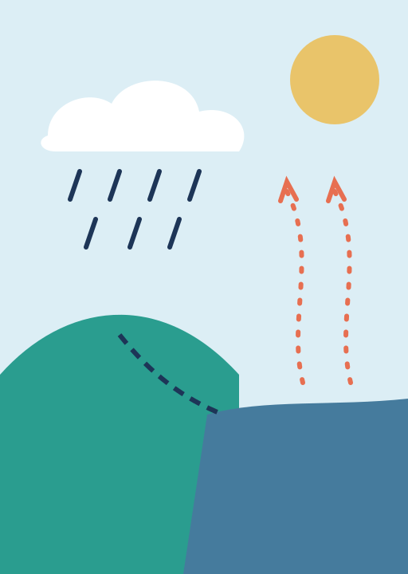

<!-- _class: title -->
<!-- _paginate: false -->

# The water cycle

Year 4 Science · Lesson 3

Ms Okoro · Elm Park Primary

---

## Today we will

- Name the four stages of the water cycle
- Explain where rain comes from
- Read a rainfall chart

<!--
Read these aloud and ask the class to show fingers: how many of these do you already know a bit about?
-->

---

<!-- _class: section -->

# Part 1

Where does rain come from?

---



## Evaporation

- The sun warms the sea, rivers and puddles
- Water turns into an invisible gas: **water vapour**
- The vapour rises into the sky

<!--
Demo: breathe on a cold window. Where did the water come from?
-->

---

## Condensation and precipitation

- High up, the vapour cools into tiny drops
- Millions of drops make a **cloud**
- Heavy drops fall as rain, hail or snow

---

## Rain in our town this year

```chart
type: line
unit: mm
caption: Rainfall in millimetres, from the school weather station.
highlight: Oct
data:
May: 48
Jun: 41
Jul: 35
Aug: 52
Sep: 66
Oct: 88
```

<!--
Ask: which month was wettest? Why might autumn be wetter? Accept any reasonable idea.
-->

---

<!-- _class: columns -->

## Quick quiz

<div class="cols">
<div>

### Questions

1. What makes water evaporate?
2. What is a cloud made of?

</div>
<div>

### Answers

1. Heat from the sun
2. Tiny drops of water

</div>
</div>

<!--
Cover the answers column (click to reveal in presenter mode) or print the slide without it.
-->

---

<!-- _class: end -->
<!-- _paginate: false -->

# Well done!

Homework: draw the water cycle and label all four stages.
