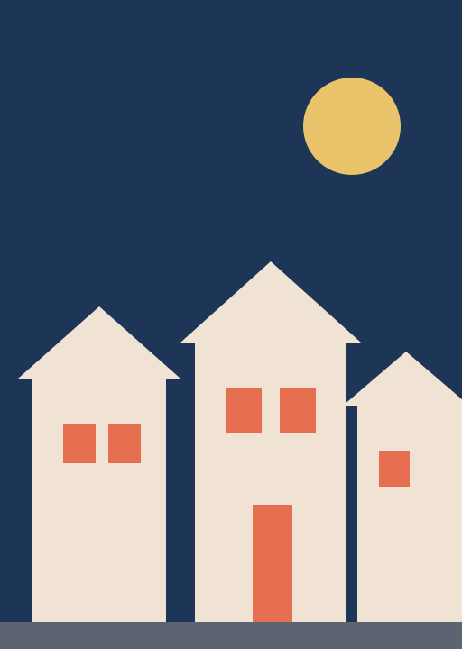

<!-- _class: title -->
<!-- _paginate: false -->


# Loamly

Borrow the tools your street already owns

Priya Raman, founder · Seed round, October 2026

<!--
Hi, I'm Priya. Loamly is a tool library for a single street. In the next ten minutes: the problem, what we built, how it's growing, and what we're raising.
-->

---



## Every street owns forty drills

- Most drills are used for **13 minutes** in their lifetime
- Neighbours rarely know what is two doors down
- Buying, storing and binning tools costs every household

<!--
The 13-minute figure is the one people quote from industry surveys; say "roughly" and move on. The real point: the tools exist, they're just locked in sheds.
-->

---


## Loamly is a tool library for one street

- A shared catalogue of what neighbours will lend
- Book a tool, collect it from the door, return it
- Deposits and reminders handled by the app

<!--
Keep this concrete: Maya on number 12 has a ladder, Tom on number 30 needs one on Saturday. Loamly makes that a two-tap booking.
-->

---

## How it works

1. **A street signs up.** One organiser invites the neighbours.
2. **Neighbours list tools.** A photo and a deposit, in a minute.
3. **Everyone borrows.** Booking, pick-up and return in the app.

<!--
The organiser matters: every successful street so far had one enthusiastic person who knocked on doors in week one.
-->

---

<!-- _class: stat -->

# 1,240

## members across our first three streets

Bristol pilot, April to September 2026

<!--
Three streets in Bristol, about 400 households each. 1,240 members is roughly a third of households.
-->

---

## Members are growing every month

```chart
type: bar
unit: members
highlight: Sep
data:
Apr: 90
May: 210
Jun: 380
Jul: 620
Aug: 910
Sep: 1240
```

<!--
Growth is word of mouth: no paid marketing yet. September is the highlighted bar: our best month.
-->

---

<!-- _class: columns -->

## How we make money

<div class="cols">
<div>

### Streets

- £2 a month per household
- Free for lenders' first year

</div>
<div>

### Councils

- Waste-reduction contracts
- Two councils in talks

</div>
</div>

<!--
Household subscriptions are live in the pilot. Council contracts are the bigger prize: tools that aren't bought are tools that aren't binned.
-->

---

<!-- _class: quote -->

## What members say

> "I borrowed a hedge trimmer on Saturday and met three neighbours I'd never spoken to."

Ruth, member since May

<!--
This quote comes up again and again: the community effect is what makes streets stick with it.
-->

---

## The ask: £400k seed

| Use of funds | Share |
|---|---|
| Launch 20 new streets | 45% |
| Product and deposits | 35% |
| Council partnerships | 20% |

<!--
Eighteen months of runway. The milestone for Series A: 20 streets and one signed council contract.
-->

---

<!-- _class: end -->
<!-- _paginate: false -->

# Thank you

priya@loamly.example

loamly.example

<!--
Leave this up during questions.
-->
